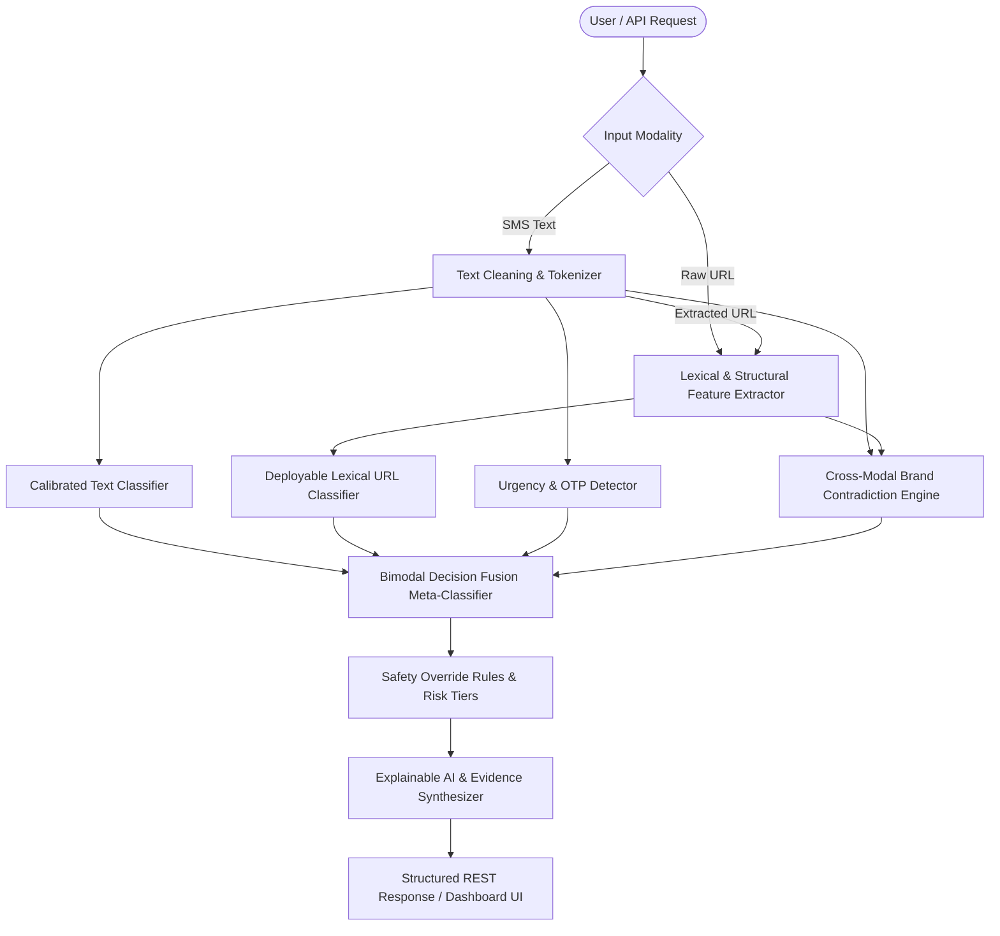

# System Architecture: Bimodal Fraud Detection (Text + URL)

## Overview

The **Bimodal Fraud Detection (Text + URL)** system provides real-time threat intelligence and scoring for suspicious SMS communications and inline URLs.

The system is engineered to solve the core challenges of modern phishing:
1. **Adversarial URL Masking**: Benign text paired with disposable phishing links.
2. **Brand Impersonation & Contradiction**: Urgent SMS claiming to be from authentic institutions (e.g. PayPal, Chase, Netflix) while redirecting to unrelated or typo-squatted domains.
3. **Domain Evasion & Filter Bypassing**: Scammers abusing link shorteners, direct IP addresses, or legitimate brand URLs while demanding phone/OTP transfer in text.
4. **Zero-Crawl Latency Constraint**: Real-time SMS scoring cannot crawl destination web pages; all URL inference runs entirely on **instant lexical and structural features**.

---

## Core Components

### 1. Lexical URL Classification Engine (`backend/architectures/url_model.py`)
- Computes **28 instantaneous structural and lexical metrics** (length, entropy, TLD risk, IP literal flag, character continuation rate, obfuscation count, special char ratios).
- Zero external HTTP calls or web crawling required (inference latency **< 0.2ms**).
- Trained on 235,370 URLs from the PhiUSIIL dataset with 99.82% accuracy and 0.9988 ROC-AUC.

### 2. Calibrated Text Classifier (`backend/architectures/text_model.py`)
- Dual-stream TF-IDF pipeline combining:
  - Word N-grams (1-2 words, 5,000 features)
  - Character N-grams (3-5 char boundary n-grams, 5,000 features)
- Calibrated logistic regression classifier providing well-calibrated posterior probabilities.
- Provides linear token coefficient attribution for explainable risk heatmaps.

### 3. Cross-Modal Contradiction Analyzer (`backend/analyzers/contradiction_analyzer.py`)
- Analyzes semantic claims in text against the destination domain in the URL.
- Identifies:
  - **Brand Impersonation**: Message claims "Chase Bank" but links to an unauthorized domain.
  - **Subdomain Deception**: Brand keyword placed inside the subdomain of a third-party root domain (e.g. `chase.com.verify-login.xyz`).
  - **Evasive Masking**: Urgent security alerts paired with URL shorteners or direct IP addresses.

### 4. Bimodal Decision Fusion Engine (`backend/architectures/fusion_model.py`)
- Decision meta-classifier integrating:
  - $P_{\text{text}}$, $P_{\text{url}}$, $S_{\text{contra}}$, $S_{\text{urgency}}$
  - Interaction terms: $P_{\text{text}} \times P_{\text{url}}$, $|P_{\text{text}} - P_{\text{url}}|$, $P_{\text{text}} \times S_{\text{contra}}$
  - High-confidence safety overrides preventing adversarial masking.
- Produces normalized risk scores (0–100) and risk tiers (`SAFE`, `MODERATE`, `HIGH`, `CRITICAL FRAUD`).

### 5. Explainable AI (XAI) Service (`backend/services/explanation_service.py`)
- Translates raw model outputs and contradiction indicators into human-readable evidence cards.
- Categorizes threats into actionable security categories with concrete defensive recommendations.
